<p align="center">
  
</p>

<p align="center">
  <a href="https://github.com/ziadmohamdd"></a>
</p>

<p align="center">
  <a href="www.linkedin.com/in/ziad-mohamed777"></a>
  <a href="https://github.com/ziadmohamdd?tab=repositories"></a>
</p>

---

### 🧠 About me

```python
class ZiadMohamed:
    role      = "AI & ML Engineer"
    focus     = ["EEG & biosignal deep learning", "Medical image analysis",
                 "RAG & LLM applications", "Multi-agent systems for finance"]
    currently = "Researching evidence verification in multi-agent investment advice"
    approach  = "Reproducible pipelines, honest baselines, negative controls"

    def say_hi(self):
        return "Open to research collaborations and AI/ML roles — let's talk!"
```

### 🛠️ Tech stack

<p align="left">
  
</p>

<p align="left">
  
  
  
  
  
  
  
  
</p>
